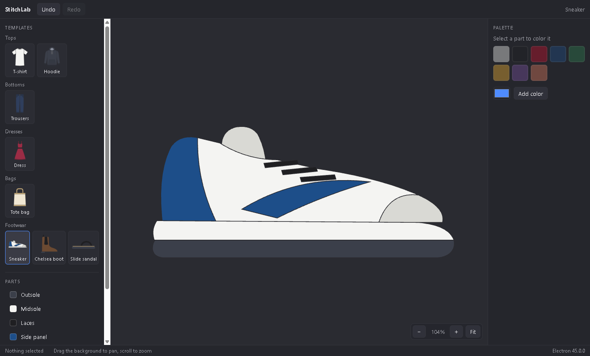

# StitchLab

Desktop app for designing clothing: start from a garment template, color its
parts, add text, graphics and patterns, and export a production-ready design.
2D editor first, 3D mannequin preview later.

**Status:** early MVP - template library (T-shirt, hoodie, trousers, dress,
tote bag, sneaker, Chelsea boot, slide sandal), per-part coloring, palette,
undo / redo, pan and zoom.



## Running locally

Requires Node.js 24+ and npm 11+.

```bash
npm install
npm run dev        # Electron app with hot reload
npm test           # unit tests (Vitest)
npm run typecheck
npm run build      # production bundle in out/
```

Electron downloads its binary in an install script; it is allowed in
`package.json` under `allowScripts`.

## Documentation

- [Product brief](docs/PRODUCT_BRIEF.md)
- [Tech stack](docs/TECH_STACK.md)
- [Branches and releases](docs/BRANCHING.md)

## Stack

Electron, TypeScript, React, PixiJS (2D), Three.js (3D). Details in
[docs/TECH_STACK.md](docs/TECH_STACK.md).
