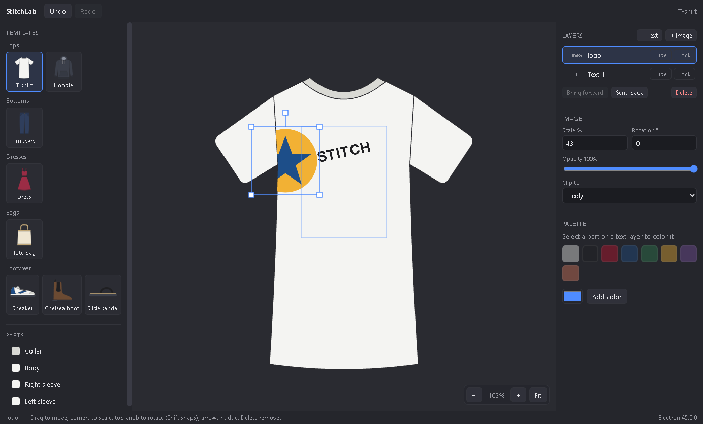

# StitchLab

Desktop app for designing clothing: start from a garment template, color its
parts, add text, graphics and patterns, and export a production-ready design.
2D editor first, 3D mannequin preview later.

**Status:** early MVP - template library (T-shirt, hoodie, trousers, dress,
tote bag, sneaker, Chelsea boot, slide sandal), per-part coloring, palette,
text and image layers with move / scale / rotate and clipping to the garment
or a single part, undo / redo, pan and zoom, and export to PNG (1x-8x,
transparent or white background), SVG (editable vector) and PDF (A4 sheet with
the design, part colors and a layer list). Projects are saved as `.stitch` files,
and unsaved work is autosaved to a recovery file that is offered on the next
start after a crash.




## Shortcuts

- `Ctrl+Z` / `Ctrl+Shift+Z` or `Ctrl+Y` - undo / redo
- `Ctrl+N` / `Ctrl+O` - new / open project
- `Ctrl+S` / `Ctrl+Shift+S` - save / save as
- `Ctrl+E` - export
- Arrows (`Shift` for 10 units) - nudge the selected layer
- `Delete` - remove the selected layer
- `Shift` while rotating - snap to 15 degrees
- `Esc` - clear selection

## Running locally

Requires Node.js 24+ and npm 11+.

```bash
npm install
npm run dev        # Electron app with hot reload
npm test           # unit tests (Vitest)
npm run typecheck
npm run build      # production bundle in out/
```

Electron downloads its binary in an install script; it is allowed in
`package.json` under `allowScripts`.

## Documentation

- [Product brief](docs/PRODUCT_BRIEF.md)
- [Tech stack](docs/TECH_STACK.md)
- [Branches and releases](docs/BRANCHING.md)

## Stack

Electron, TypeScript, React, PixiJS (2D), Three.js (3D). Details in
[docs/TECH_STACK.md](docs/TECH_STACK.md).
